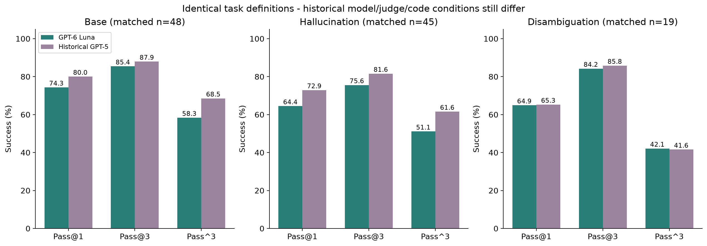
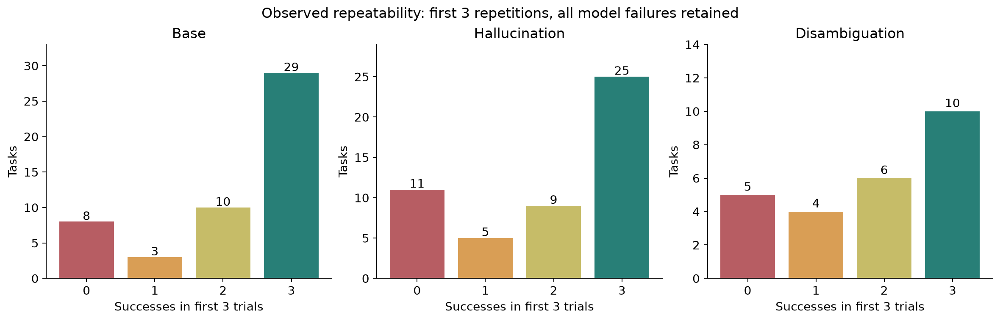

# CAR-bench：GPT-6 Luna 三类任务复现

> 最新扩展：[三类任务对比报告](outputs/extension/comparison-report.html) · [扩展实验数据与图表](outputs/extension/)

## 首批：Disambiguation

2026-10-19 完成。使用作者当前官方 Disambiguation **test split 的 25 道题，每题 3 次，共 75 次有效试验**。GPT-6 Luna（medium reasoning）作答，Gemini 2.5 Flash thinking 模拟用户，沿用原评分逻辑。

| 指标 | 结果 |
|---|---:|
| Pass@1：单次成功率 | 61.3% |
| Pass@3：三次至少成功一次 | 80.0% |
| Pass^3：三次全部成功 | 40.0% |
| 一致性差距 | 40.0 个百分点 |

10 题三次全成功，10 题时成时败，5 题三次全失败。一致性问题仍存在。在定义完全相同的 19 道历史题目上，Luna 与 GPT-5 的 Pass^3 为 42.1% 与 41.6%；差值的配对 bootstrap 95% 区间为 −24.7 至 +24.2 个百分点，不能据此声称明显改善。历史代码、评分器和服务版本未控制，这不是严格的模型升级对照实验。

费用按返回 token 估算：OpenAI **$0.102829**，Gemini **$0.596416**，合计 **$0.699245**，包括连通性测试及中断前调用；最终以平台账单为准。原运行使用 OpenAI 独立项目 $10 月度硬上限，程序另外在 OpenAI $9.50、Gemini $4.50 前停止。GitHub 中的代码不会为新用户自动配置平台限额；Gemini 控制仅覆盖本程序。

## 数据与证据

- [完整报告](outputs/report.html)（下载后用浏览器打开），[逐题结果](outputs/per-task-results.csv)、[指标及置信区间](outputs/summary.json)。
- [全部 75 次对话与评分](outputs/trajectories/)、[原题快照](outputs/test-tasks.json)、[失败分项](outputs/failures.json)。
- [逐请求费用账本](outputs/usage-ledger.json)、[模型与数据配置](outputs/manifest.json)。
- [历史题目定义审计](outputs/baseline-task-audit.json)、[历史同题对照](outputs/historical-comparison.json)。
- [中断与补跑记录](outputs/infrastructure-errors/)、[原始运行日志](evidence/)、[源码来源与论文 SHA-256](evidence/provenance.json)。
- [SHA-256 文件校验清单](evidence/checksums.sha256)：覆盖上传文件（不包含清单自身及 Git 元数据）。

只有 disambiguation_47 的 trial 1 因 Windows 本地费用文件锁错误补跑一次；中断发生在该次 Gemini 请求发出前，原错误已保留。其他模型失败未重跑。中断还取消了队列末尾 5 道尚未开始的题，随后继续完成；最终每题均恰好 3 个有效结果。模拟用户也可能偏离脚本，报告包含案例说明。

## 复核结果（无需 API 密钥，不产生 API 费用）

本仓库包含实际使用的复现脚本、上游源码及用于比较的 GPT-5 原始历史结果。上游其他历史结果和 Git 历史省略；被复制的上游文件保持原样，来源 commit 为 `ce6dc9d08f4ff81eb4c1a5c317aff25112ee950b`。

原环境：Python 3.12.14 / Windows。建议使用独立虚拟环境：

```sh
python -m venv .venv
# Windows: .venv\Scripts\activate
# macOS/Linux: source .venv/bin/activate
python -m pip install -r work/dependency-versions.txt
python -m unittest discover -s work -p test_budget.py
python work/analyze_experiment.py
python work/build_report.py
```

依赖清单是原环境快照；跨平台安装可能需要处理平台差异。分析会重写派生报告及依赖快照，请先保留原始提交作对照。无需下载完整地图数据即可重新计算指标。

## 重新运行付费实验

1. 将 `.env.example` 复制为 `.env.local`，在本地填入自己的 OpenAI 与 Gemini API 密钥。不要提交密钥。
2. 保留仓库原始提交。要做全新实验，先把整个 `outputs/` 目录移到仓库外备份；程序会自动创建新的输出目录。已有完整轨迹会被跳过，因此直接运行不会重做这 75 次试验。
3. 执行下列命令。首次会从 Hugging Face 下载固定版本环境数据（包含较大的地图和路线数据），需要网络及足够磁盘空间：

```sh
python work/experiment.py --tasks 25 --jobs 3
```

数据集：`johanneskirmayr/car-bench-dataset`，固定 revision `1fcf24ad802c42e04a0d8fe05b5ca0d481a4e7af`。所有原始任务与工具环境来自该数据集；仓库保存本次使用的 25 题快照，完整地图数据由脚本按版本下载，未重复上传。

新运行结束后，若需同样历史审计，请将备份中的 `baseline-task-audit.json` 复制到新 `outputs/` 再运行分析。`repair_infrastructure_trial.py` 是本次特定故障的审计工具，不是常规运行步骤，不应直接重用。只允许一个实验进程运行：费用保护在线程间共享，不跨进程共享。

云端模型有随机性、别名可能更新；固定数据和源码不保证逐字或逐分复现。此实验仅涉及 Disambiguation，未测试论文其他任务，也没有 reasoning=none 因果对照。

## 来源与许可

作者仓库：https://github.com/CAR-bench/car-bench

上游源码及其资源保留原路径和 [MIT 许可证](work/car-bench/LICENSE)。数据集内容遵循其原始许可与署名要求；本仓库不为第三方数据授予额外许可。原论文 PDF 未再分发，其文件摘要保存于 provenance。密钥、私人加密密钥、虚拟环境与下载缓存均不在仓库中。

## 三类任务扩展实验

新增 Base 与 Hallucination，仍使用原模型与固定数据版本，累计预算包含前次 Disambiguation。先每题三次，再均衡增加重复。用户在第七轮要求停止 Base/Hallucination，随后要求将 Disambiguation 补至六轮，仍受总预算保护。用户后续追加 Gemini NZ$10；程序保守增加 US$5 额度，累计本地停止线调整为 US$9.50，完成补跑即停止，不继续耗尽充值。预算中断不作为模型失败。

| 类别 | 完成三轮/总题数 | 全部有效试验 | Pass@1 | Pass@3 | Pass^3 |
|---|---:|---:|---:|---:|---:|
| base | 50/50 | 341 | 73.3% | 84.0% | 58.0% |
| hallucination | 50/50 | 343 | 65.3% | 78.0% | 50.0% |
| disambiguation | 25/25 | 150 | 61.3% | 80.0% | 40.0% |

表中主指标仅使用前三次；额外重复在补充结果中单独报告。累计估算费用：OpenAI $0.930797，Gemini $4.989678。其中 3 次服务异常或进程中断未返回用量，保留 $0.078386 最坏情况费用预留，未将其视为免费。

六轮对齐补充结果（k=3 的组合估计）：

| 类别 | 完整轮次 | Pass@1 | Pass@3 | Pass^3 |
|---|---:|---:|---:|---:|
| base | 6 | 75.3% | 87.1% | 61.5% |
| hallucination | 6 | 66.0% | 77.3% | 53.3% |
| disambiguation | 6 | 56.7% | 75.8% | 37.8% |

[PDF 报告](outputs/extension/CAR-bench_三类任务六轮对比报告.pdf) · [完整对比报告](outputs/extension/comparison-report.html) · [详细汇总与区间](outputs/extension/summary.json) · [逐题结果](outputs/extension/per-task-results.csv) · [题目定义审计](outputs/extension/task-definition-audit.json) · [停止事件](outputs/extension/events.jsonl)





其他图表（PNG/SVG）位于 `outputs/extension/`。论文表格概览与同题历史对照分开展示；历史代码/模拟用户/评分器未完全控制，不能把差异完全归因于模型升级。Hallucination 任务失败率不等同于直接观测到的编造率。

无需密钥的重新分析：`python work/analyze_extension.py`，然后 `python work/plot_extension.py`。付费扩展入口是 `python work/extend_experiment.py`，使用已有凭据，继承之前费用账本；请先阅读源代码中的停止条件。它不会自动设置平台预算，且不得与其他实验进程同时运行。

`outputs/usage-ledger.json` 是前次消歧实验账本；`outputs/extension/usage-ledger.json` 包含其完整前缀及新增调用，累计费用以扩展账本为准，不要把两个账本相加。原始报告保持历史结果，新结论以扩展报告为准。
